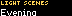
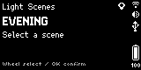

# Light Scenes for BUSY Bar

 

Activate your selected lighting scenes with confirmation.

Category: **Smart Home**.

## Screenshots

Captured from a physical BUSY Bar. See [capture details](docs/SCREENSHOTS.md)
for firmware, settings and sample-data provenance.

## Controls

Wheel selects a scene. Press OK twice to activate. Back cancels confirmation or exits.

## Settings

Open **Apps → Light Scenes → Setup**. Saved settings are read when the app starts.

| Setting | Type | Default |
| --- | --- | --- |
| Source URL | string |  |
| Access token | string |  |
| Refresh (sec) | integer | 30 |
| Provider | enum | json |
| Name=scene entries | string | Evening=scene.evening;Work=scene.work |

Set semicolon-separated Name=scene.entity_id entries. Home Assistant mode posts to /api/services/scene/turn_on. JSON mode posts {"scene":"scene.entity_id"} to Source URL/command and requires {"result":"ok"} as acknowledgement.

Access token is sent as a Bearer token. Configure URLs and credentials in the web settings. Remote sources require Wi-Fi.

## Install and build

Use the Node.js version in [.nvmrc](.nvmrc) and the pnpm version in [package.json](package.json).

    corepack pnpm install --frozen-lockfile
    corepack pnpm check
    corepack pnpm app:install
    corepack pnpm app:run

Pass --addr <host> to an app command to select a device. See [INSTALL.md](INSTALL.md).
The minimum firmware HTTP API is specified in [src/appmeta/manifest.json](src/appmeta/manifest.json).

## Development

Each project contains its own runtime, state model, assets, tests and build scripts.
Run pnpm check for metadata validation, type checking, unit tests, packaging and bundle smoke checks.
Run pnpm release to prepare a versioned archive and SHA256SUMS locally.
Generated files under dist/ are excluded from Git.

See [CONTRIBUTING.md](CONTRIBUTING.md) and [docs/RELEASING.md](docs/RELEASING.md).

## License

Code, pixel icons, geometric artwork and synthesized sound assets: [MIT](LICENSE).
Assets can be recreated with python art/generate_assets.py. Rendering uses fonts supplied by the BUSY Bar firmware.

## AI assistance

See [AI_ASSISTANCE.md](docs/AI_ASSISTANCE.md) for the role of AI in this project.
